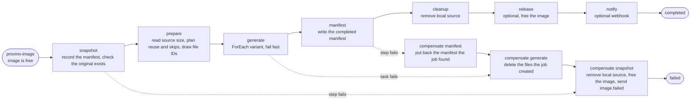

# Jobs: the image actor and the job workflow

Everything provino does after accepting a request runs as a job: every upload (from a browser or a backend) and every optimize request becomes one, with or without variants. Each job runs as a [Francis workflow](https://gofrancis.dev/workflows/), and the jobs of one image run one at a time.

Francis owns the actors, the workflow journal, retries, deadlines, retention and purging. provino declares the image actor and the workflow graph, and supplies idempotent handlers for the work itself.

## The image actor

Every job writes its image's manifest, and a failed job puts back the manifest it found, so two jobs of one image running at once would undo each other's work. Francis has no way to keep a workflow to one running instance per key, so the `provino-image` actor, addressed as `<namespace>:<imageId>`, does it: it starts a job's workflow only when no other job of the image is running, and refuses the job otherwise. A refused job isn't kept anywhere: the caller gets `409 image_busy` and sends it again once the image is free. Francis forbids `/` in actor IDs, and a namespace can't contain `:`, so the two parts never run into each other.

Its state is the active job, a short history of finished jobs, and the claim of an upload that is storing the image. It has five methods and an alarm:

| Method | What it does |
| --- | --- |
| `start` | Refuses a job while another job of the image is active. It also refuses a job without an upload's `source` while an upload holds the claim, since the original isn't stored yet and the job would fail with `image_not_found`; the upload's own job carries `source`. Otherwise it mints a UUIDv7 job ID, records the job as active, and starts its workflow. A job whose workflow can't be started isn't accepted, so the caller finds out at once |
| `finished` | Called by the workflow when it ends, it moves the active job to the history, which frees the image for its next job. A call about a job that isn't active is a repeat, and changes nothing |
| `claim` | Holds the image's ID for an upload that named it, until the upload releases it or the claim expires (`server.readTimeout` plus a minute). It refuses when another upload holds the ID, or when a job of the image is active. The upload checks that nothing is stored for the ID only once it holds the claim, which is what keeps two uploads of the same ID from both passing that check |
| `release` | Gives up the claim an upload holds, once its job has started or the upload failed. A release from an upload that doesn't hold the claim changes nothing |
| `job` | A read-only peek, which reports whether a job is active or recently finished, along with the hash of the subject that started it |
| The `check` alarm | The safety net. While a job is active it fires every minute, and at the latest after the job's deadline. It also fires when a claim expires, and when the oldest history entry expires. With `actors.completedWorkflowRetention` at `0` the history never expires, so an image with nothing active or claimed has no alarm at all; if the retention changes later, its history is pruned the next time the image gets a job or a claim |

The actor schedules its alarm, then records a job as active along with its request, and only then starts its workflow. If the process dies before the start, the actor is left holding an active job whose workflow doesn't exist, and the alarm is already there to find it. `heal` runs on every `start`, `claim` and alarm, and reads the active job's journal. A `start` or `claim` that is refused saves the state only when `heal` changed it, so a caller retrying against a busy image doesn't cost a write each time. It moves on when the workflow has ended. When the workflow doesn't exist and its journal can't have been purged yet (less than `actors.completedWorkflowRetention` has passed since the job became active, going by the shorter of the retention recorded on the job when it became active and the current one, since raising it doesn't bring back a purged journal), the workflow was never started, so `heal` starts it from the kept request; a start that did happen after all is found by its job ID and discarded. Otherwise the job is freed. The request is dropped from the state once the workflow is known to exist. Starting the workflow first would risk one running without the actor knowing, and then nothing would stop the next job from racing it.

The image stays busy until the job's `release` step, which comes before `notify`, so a slow or failing webhook receiver doesn't keep the image busy: delivering an event touches nothing in the store. The cost is that the events of two jobs of one image that run back to back can arrive out of order, which the event's `timestamp` lets a receiver sort out. Polling the active job every minute is what bounds a lost release: if the `release` step gives up, the image is freed at the next check rather than at the job's deadline.

The history keeps the subject hash of finished jobs for as long as their journal is retained (`actors.completedWorkflowRetention`, and at most 50 jobs), so a browser can read the status of its own jobs after they finish. An image with nothing active, remembered or claimed deletes its state, so the actors of every image ever uploaded don't accumulate.

## Workflow definition

The workflow is named `provino-job`, and its definition version is explicit. Any change to the graph or its policies that affects the definition fingerprint must also increment `jobWorkflowVersion`.

A job's workflow instance ID is `<namespace>:<imageId>:<jobId>`. Binding the instance to its image means a status lookup built from a URL can only ever find a job under the image it belongs to.

| Step | Francis node | Responsibility |
| --- | --- | --- |
| `snapshot` | Plain step, compensated also when it fails | Reads the image's manifest byte for byte, so a failed job can put back exactly what it found. It works out the original's format, size and dimensions: from what the upload measured, else from the manifest, else from the request's `sourceFormat`. It then checks the original exists. A missing original, or an image with no manifest and no `sourceFormat`, fails the job permanently with `image_not_found`. |
| `prepare` | Plain step | Returns no items for a job without variants. Otherwise it learns the source's size (from the snapshot or the source's header) and marks two kinds of variant. A box the source can't fill is skipped when a tighter box of the same fit, format and quality produces the same file, and a variant whose manifest entry and stored file still match is reusable. Every other variant gets a random file ID. It prefetches the source only when something is left to encode. |
| `generate` | `ForEach` with `FailFast` and task compensation | Returns at once for a skipped item, returns stored metadata for a reusable one, or has libvips encode one variant from the source's path in the local cache, stores it at a key named after the size it came out at and the item's file ID, and returns a `VariantResult` with that key. An empty fan-out completes on its own. |
| `manifest` | Required step, compensated also when it fails | Builds the `provino/v1` manifest from the durable outputs, with the full object key of every file, and writes it. A job without variants writes nothing, because the upload already stored the manifest, and returns the manifest it found. This step is the workflow's output. |
| `cleanup` | Step that can't fail | Removes this host's cached source and records the outcome metric. It runs before `release`, so it can't remove a copy of the source the image's next job just downloaded. |
| `release` | Optional step | Tells the image's actor the job is done, which frees the image for its next job. If it can't, the actor's alarm notices on its own, within a minute. |
| `notify` | Optional step, reading the `manifest` output | Delivers `image.stored` (no variants) or `image.optimized` to the endpoint the job resolved when it was requested. Exhausted retries are recorded by Francis and don't fail the job. The image is already free while it runs. |

Every step after `manifest` is optional or can't fail, so a job whose variants are stored never unwinds them because a notification or a local cleanup went wrong.

The job service maps Francis' journal onto the job status: a running, suspended or compensating instance reads as `running`, as does an active job whose journal doesn't exist yet, a completed instance as `completed`, and a failed or cancelled one as `failed`, with its cause as the error.

## Durable data flow

The complete `JobRequest` is the instance input. `snapshot` returns a `jobSnapshot`, which the later steps read through `WithInputFrom` (compensations included). `prepare` returns an ordered array of `variantTask` values that sizes the fan-out. Francis journals every successful task output in the same order, so `manifest` combines each result with its spec without any state of its own.

The manifest's timestamps come only from durable values. `StartedAt` comes from the snapshot, and `CompletedAt` is the latest result time, so a retried manifest step writes the same bytes.

## Never enlarging

No variant is larger than its source. A box the source can't fill gets the source's own pixels: the whole source with `contain`, or with `cover` the largest centered crop of the box's shape, which `imaging.FullResolution` computes. Every such box of one fit, format and quality produces the same file, so `prepare` keeps only the tightest, by `imaging.ScaleFactor`, and skips the others. The encoder enforces the same rule on its own.

A box the source can't fill may reuse a stored file of another box when that file has the same fit, format, quality and full-resolution size.

## Variant keys and reuse

A variant is stored at a key that names the size it came out at and ends with a random file ID (`imagekeys.AssetKey`), such as `<imageId>_600x400_3f9a0c1e.webp`. `prepare` draws the file ID of every variant that encodes, and draws again when the previous manifest or another variant of the job already uses it (`assignFileIDs`). The ID is part of `prepare`'s journaled output, and the size is known only once the variant is encoded, so `generate` builds the key and returns it in its result, where `manifest` and the compensation read it. So:

- Every file a job encodes is a new object. A job never writes over a file the previous manifest lists, so a failed job that puts that manifest back leaves every file it lists holding the bytes it describes, and a key's bytes never change, so applications can serve variants as immutable.
- Two variants that come out at the same size, such as `600x600` and `600xauto` for a 3:2 source, are two files, each with its own settings.
- A variant asked for at another quality is encoded again, into a new file, and the old file stays in the store.
- The store can't list an image's files, so a file no manifest lists any more isn't checked when a file ID is drawn. Sharing its key would also take the same size and format, and a 1 in 4 billion draw.

`prepare` finds reusable files by the key each entry of the previous manifest records, and only when that key belongs to the image (`imagekeys.OwnsKey`) and the file exists. A stored entry is reused for a variant of the same box, fit, format and quality, whatever its effort. Since the key comes from the manifest, files stored under an older layout's names, such as `<imageId>_600x400.webp`, are reused as they are.

## Idempotency

Workflow tasks are delivered at least once, so every handler stays idempotent:

- Starting a job twice finds the instance its job ID names and discards the second start.
- `snapshot` only reads.
- Planning depends only on the source's size and the requested set, and an original never changes once stored, so a retried `prepare` plans the same work. It may draw other file IDs, but nothing uses them before its output is journaled.
- A retried variant encodes the same source to the same size, with the file ID from `prepare`'s output, so it overwrites the same key.
- A retried manifest step writes the same document to the same key.
- Compensations are safe to repeat: deleting a missing object succeeds, and restoring the manifest writes the same bytes.
- `finished` ignores a job that isn't the active one, so a repeated release changes nothing.
- Delivery IDs are derived from the job ID and the event type, so a receiver can tell a retry from a new event.
- Source removal is safe to repeat, and the cache sweeper removes the files a host left behind.

## Failures and compensation

A failed job leaves the image as it found it:

1. `generate`'s compensation deletes the file each encoded variant stored, at the key its result records, after checking that the key belongs to the image. Every such file is new, so nothing another job or an application references is deleted, while reused and skipped variants stored nothing. An attempt that stored its file and then failed, and was never retried to completion, leaves that file behind, and keeping an orphaned file is the harmless mistake.
2. `manifest`'s compensation, which also runs when the step itself failed partway, puts back the manifest the job found, or removes it when there was none.
3. `snapshot`'s compensation runs last. It removes the local source, then frees the image before delivering anything, so a failure event that can't be delivered doesn't hold up the next job. It then delivers `image.failed`, carrying the manifest the image is left with. It tries the delivery up to five times and then gives up, so an unreachable endpoint can't stall the unwind.

Generation tells failures apart by whether another attempt could help. Invalid requests and unreadable sources fail permanently, while storage and network failures use Francis' attempt and backoff policy.

## Deadlines, placement and retention

Each forward attempt and compensation uses `actors.workflowTimeout` as its execution budget, which starts only when a worker begins the attempt. The workflow also has an instance deadline of six times that value.

`images.maxConcurrentEncodes` becomes the workflow's per-host worker budget, which Francis shares across every step's queue and mirrors as a placement hint, so work can move to another host.

The source cache is local. A task placed away from the host that prepared the job downloads the source into its own cache, and the sweeper reclaims that copy after twice `actors.workflowTimeout`. libvips reads the cached file by its path, so the source never sits in the Go heap; an encode that fails because a sweep removed the file in the meantime is retried, which downloads it again.

`actors.completedWorkflowRetention` applies to completed, failed and cancelled journals, and to the image actor's history. After it, the status endpoint returns `404`, and the manifest in object storage remains the durable record.

The end-to-end tests in this package skip themselves under the race detector, so `make test-race` doesn't run them. `make test-workflows` runs them without it, and is the only end-to-end coverage of the workflow.
