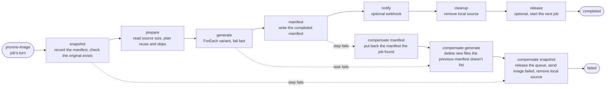

# Jobs: the image queue and the job workflow

Everything provino does after accepting a request runs as a job: every upload (from a browser or a backend) and every optimize request becomes one, with or without variants. A job waits in its image's queue, and when its turn comes it runs as a [Francis workflow](https://gofrancis.dev/workflows/).

Francis owns the actors, the workflow journal, retries, deadlines, retention and purging. provino declares the queue actor and the workflow graph, and supplies idempotent handlers for the work itself.

## The image queue

The jobs of one image run one at a time, in the order they were queued, so two jobs never write the same manifest at once. The `provino-image` actor, addressed as `<namespace>:<imageId>`, holds the queue. Francis forbids `/` in actor IDs, and a namespace can't contain `:`, so the two parts never run into each other.

Its state is the active job, the jobs waiting behind it (each with its full `JobRequest`), and a short history of finished jobs:

- **`enqueue`** refuses a job when `images.maxQueuedJobs` are already waiting. Otherwise it mints a UUIDv7 job ID, appends the job, and starts it right away when nothing is active. It returns the job ID and its `position: 0` when it started, its place in the queue otherwise. A job whose workflow can't be started isn't accepted, so the caller finds out at once.
- **`finished`**, called by the workflow when it ends, moves the active job to the history and starts the next one. A call about a job that isn't active is a repeat, and changes nothing.
- **`job`**, a read-only peek, reports whether a job is active, queued (with its position) or recently finished, along with the hash of the subject that started it.
- **The `check` alarm** is the safety net. It fires after the active job's deadline, after a failed start, and when the oldest history entry expires.

The actor records a job as active before starting its workflow. If the process dies in between, the actor is left holding an active job whose workflow doesn't exist, and `heal` frees it: every `enqueue` and every alarm reads the active job's journal, and moves on when the workflow has ended or doesn't exist. Starting the workflow first would risk one running without the actor knowing, and then nothing would stop the next job from racing it.

The actor holds the queue itself, rather than starting every job as a workflow parked on a `WaitForEvent` step, for two reasons. Francis counts a workflow's waiting time against its deadline. And `RaiseEvent` records nothing when it arrives before the wait step is open, while its idempotency key makes raising it again unreliable, so a "your turn" event could be lost.

The history keeps the subject hash of finished jobs for as long as their journal is retained (`actors.completedWorkflowRetention`, and at most 50 jobs). That is what lets a browser read the status of its own jobs after they finish. An image with nothing active, queued or remembered deletes its state, so the actors of every image ever uploaded don't accumulate.

## Workflow definition

The workflow is named `provino-job`, and its definition version is explicit. Any change to the graph or its policies that affects the definition fingerprint must also increment `jobWorkflowVersion`.

A job's workflow instance ID is `<namespace>:<imageId>:<jobId>`. Binding the instance to its image means a status lookup built from a URL can only ever find a job under the image it belongs to.

| Step | Francis node | Responsibility |
| --- | --- | --- |
| `snapshot` | Plain step, compensated also when it fails | Reads the image's manifest byte for byte, so a failed job can put back exactly what it found. It works out the original's format, name, size and dimensions: from what the upload measured, else from the manifest, else from the request's `sourceFormat`. It then checks the original exists. A missing original, or an image with no manifest and no `sourceFormat`, fails the job permanently with `image_not_found`. |
| `prepare` | Plain step | Returns no items for a job without variants. Otherwise it learns the source's size (from the snapshot or the source's header) and marks two kinds of variant. A box the source can't fill is skipped when a tighter box of the same fit and format produces the same file, and a variant whose manifest entry and stored file still match is reusable. It prefetches the source only when something is left to encode. |
| `generate` | `ForEach` with `FailFast` and task compensation | Returns at once for a skipped item, returns stored metadata for a reusable one, or reads the source through the local cache, encodes one variant, stores it, and returns a `VariantResult`. An empty fan-out completes on its own. |
| `manifest` | Required step, compensated also when it fails | Builds the `provino/v1` manifest from the durable outputs, with the full object key of every file, and writes it. A job without variants writes nothing, because the upload already stored the manifest, and returns the manifest it found. This step is the workflow's output. |
| `notify` | Optional step | Delivers `image.stored` (no variants) or `image.optimized` to the endpoint the job resolved when it was queued. Exhausted retries are recorded by Francis and don't fail the job. |
| `cleanup` | Step that can't fail | Removes this host's cached source and records the outcome metric. |
| `release` | Optional step | Tells the image's queue the job is done. If it can't, the actor's alarm notices on its own. |

Every step after `manifest` is optional or can't fail, so a job whose variants are stored never unwinds them because a notification or a local cleanup went wrong.

The job service maps Francis' journal onto the job status: a queued job (known only to the actor) reads as `queued`, a running, suspended or compensating instance as `running`, a completed instance as `completed`, and a failed or cancelled one as `failed`, with its cause as the error.

## Durable data flow

The complete `JobRequest` is the instance input. `snapshot` returns a `jobSnapshot`, which the later steps read through `WithInputFrom` (compensations included). `prepare` returns an ordered array of `variantTask` values that sizes the fan-out. Francis journals every successful task output in the same order, so `manifest` combines each result with its spec without any state of its own.

The manifest's timestamps come only from durable values. `StartedAt` comes from the snapshot, and `CompletedAt` is the latest result time, so a retried manifest step writes the same bytes.

## Never enlarging

No variant is larger than its source. A box the source can't fill gets the source's own pixels: the whole source with `contain`, or with `cover` the largest centered crop of the box's shape, which `imaging.FullResolution` computes. Every such box of one fit and format produces the same file, so `prepare` keeps only the tightest, by `imaging.ScaleFactor`, and skips the others. The encoder enforces the same rule on its own.

A stored file larger than its source was enlarged before this rule existed, so it's never reused. A box the source can't fill may also reuse a stored file of another box when that file has the same fit, format and full-resolution size.

## Idempotency

Workflow tasks are delivered at least once, so every handler stays idempotent:

- Starting a job twice finds the instance its job ID names and discards the second start.
- `snapshot` only reads.
- Planning depends only on the source's size and the requested set, and an original never changes once stored, so a retried `prepare` plans the same work.
- A retried variant encodes the same source and overwrites the same key.
- A retried manifest step writes the same document to the same key.
- Compensations are safe to repeat: deleting a missing object succeeds, and restoring the manifest writes the same bytes.
- `finished` ignores a job that isn't the active one, so a repeated release changes nothing.
- Delivery IDs are derived from the job ID and the event type, so a receiver can tell a retry from a new event.
- Source removal is safe to repeat, and the cache sweeper removes the files a host left behind.

## Failures and compensation

A failed job leaves the image as it found it:

1. `generate`'s compensation deletes the files this job stored, except any the previous manifest still lists. Re-encoding a size and format overwrites the same key, so deleting it would break the manifest that's about to be put back. Keeping an orphaned file is the harmless mistake, so a compensation that can't read the snapshot keeps the file.
2. `manifest`'s compensation, which also runs when the step itself failed partway, puts back the manifest the job found, or removes it when there was none.
3. `snapshot`'s compensation runs last. It releases the image's queue first, so a failure event that can't be delivered doesn't hold up the next job. It then delivers `image.failed`, carrying the manifest the image is left with, and removes the local source. It tries the delivery up to five times and then gives up, so an unreachable endpoint can't stall the unwind.

Generation tells failures apart by whether another attempt could help. Invalid requests and unreadable sources fail permanently, while storage and network failures use Francis' attempt and backoff policy.

## Deadlines, placement and retention

Each forward attempt and compensation uses `actors.workflowTimeout` as its execution budget, which starts only when a worker begins the attempt. The workflow also has an instance deadline of six times that value. A job's wait in its image's queue happens before its workflow exists, so it counts against neither.

`images.maxConcurrentEncodes` becomes the workflow's per-host worker budget, which Francis shares across every step's queue and mirrors as a placement hint, so work can move to another host.

The source cache is local. A task placed away from the host that prepared the job downloads the source into its own cache, and the sweeper reclaims that copy after twice `actors.workflowTimeout`.

`actors.completedWorkflowRetention` applies to completed, failed and cancelled journals, and to the image actor's history. After it, the status endpoint returns `404`, and the manifest in object storage remains the durable record.

The end-to-end tests in this package skip themselves under the race detector, so `make test-race` doesn't run them. `make test-workflows` runs them without it, and is the only end-to-end coverage of the workflow.
