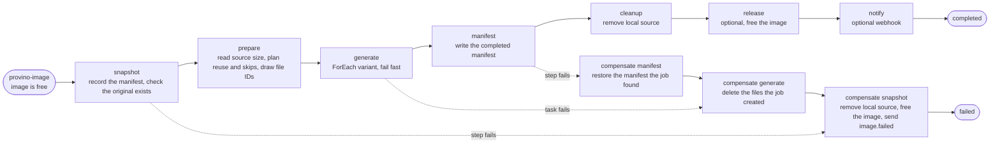

# Jobs: the image actor and the job workflow

Every upload (from a browser or a backend) and every optimize request runs as a job, with or without variants. Each job is a [Francis workflow](https://gofrancis.dev/workflows/), and an image runs one job at a time.

Francis owns the actors, the workflow journal, retries, deadlines, retention and purging. provino declares the image actor and the workflow graph, and supplies idempotent handlers for the work.

## The image actor

Every job writes its image's manifest, and a failed job restores the manifest it found, so two concurrent jobs of one image would undo each other's work. Francis can't limit a workflow to one running instance per key, so the `provino-image` actor does it: it starts a job only when the image has no other active job. A refused job isn't queued; the caller gets `409 image_busy` and retries once the image is free.

The actor's ID is `<namespace>:<imageId>` (Francis forbids `/` in actor IDs, and namespaces can't contain `:`). Its state holds the active job, a short history of finished jobs, and the claim of an upload that is storing the image.

| Method | What it does |
| --- | --- |
| `start` | Refuses the job if another job is active, or if an upload holds the claim and the job has no `source`: only the upload's own job carries `source`, and any other would fail with `image_not_found` because the original isn't stored yet. Otherwise it mints a UUIDv7 job ID, records the job as active, and starts its workflow. If the workflow can't be started, the job isn't accepted and the caller gets the error. |
| `finished` | Called by the workflow when the job ends. Moves the active job to the history, which frees the image. A call for a job that isn't active is a repeat and changes nothing. |
| `claim` | Reserves the image ID for an upload that named it, until the upload releases it or the claim expires (`server.readTimeout` plus a minute). Refused when another upload holds the claim or a job is active. The upload checks that nothing is stored under the ID only after it holds the claim, so two uploads of one ID can't both pass the check. |
| `release` | Drops the upload's claim once its job has started or the upload failed. A release from an upload that doesn't hold the claim changes nothing. |
| `job` | Read-only. Reports whether a job is active or recently finished, with the hash of the subject that started it. |
| `check` (alarm) | While a job is active, fires every minute and no later than a minute past the job's deadline. Also fires when a claim expires and when the oldest history entry expires. With `actors.completedWorkflowRetention` at `0` the history never expires, so an image with nothing active or claimed has no alarm; if the retention changes later, the history is pruned on the image's next `start` or `claim`. |

### Starting and recovering jobs

`start` schedules the alarm, records the job as active, and only then starts the workflow. In the opposite order, a crash could leave a workflow running that the actor doesn't know about, and the next job would race it. If the process stops before the workflow starts, the alarm frees the image.

`heal` runs on every `start`, `claim` and alarm. It keeps the image busy while the active job's workflow exists and hasn't ended, and frees it otherwise. Francis reports a started workflow that isn't running yet as `pending`, so a missing workflow either never started or was already purged. One that never started belongs to a `start` that failed or never returned, whose caller already got an error (an upload has also deleted its original by then). A failed start still leaves the job active, because Francis may have recorded the workflow before the error, and `heal` frees the image only once the workflow is confirmed missing.

A refused `start` or `claim` saves state only when `heal` changed it, so retries against a busy image don't each cost a write.

### Release, history and cleanup

The `release` step frees the image before `notify` runs, so a slow or failing webhook receiver doesn't hold up the next job (delivering an event doesn't touch the store). The trade-off is that events from two back-to-back jobs of one image can arrive out of order; receivers can order them by `timestamp`.

The history keeps the subject hash of up to 50 finished jobs for as long as their journals are retained (`actors.completedWorkflowRetention`), so a browser can read the status of its own jobs after they finish. An actor with no active job, history or claim deletes its state, so actors don't accumulate for every image ever uploaded.

## Workflow definition

The workflow is named `provino-job` and has an explicit definition version. Any change to the graph or its policies that changes the definition fingerprint must also increment `jobWorkflowVersion`.

A job's instance ID is `<namespace>:<imageId>:<jobId>`, so a status lookup built from a URL can only find jobs of that image.

| Step | Francis node | Responsibility |
| --- | --- | --- |
| `snapshot` | Plain step, compensated even when it fails | Reads the image's manifest byte for byte, so a failed job can restore it exactly. Takes the original's format, size and dimensions from the upload's measurements, else the manifest, else the request's `sourceFormat`, then checks that the original exists. A missing original, or no manifest and no `sourceFormat`, fails the job permanently with `image_not_found`. |
| `prepare` | Plain step | Returns no items for a job without variants. Otherwise it reads the source's size (from the snapshot or the file header), marks variants to skip or reuse (see [Never enlarging](#never-enlarging) and [Variant keys and reuse](#variant-keys-and-reuse)), and draws a random file ID for every other variant. Prefetches the source only if something needs encoding. |
| `generate` | `ForEach` with `FailFast` and task compensation | Returns immediately for a skipped item and returns the stored metadata for a reusable one. Otherwise it encodes the variant with libvips from the cached source's path, stores it under a key built from its output size and file ID, and returns a `VariantResult` with that key. An empty fan-out completes on its own. |
| `manifest` | Required step, compensated even when it fails | Builds the `provino/v1` manifest from the journaled outputs, with the full object key of every file, and writes it. A job without variants writes nothing (the upload already stored the manifest) and returns the manifest it found. Its output is the workflow's output. |
| `cleanup` | Step that can't fail | Removes this host's cached source and records the outcome metric. It runs before `release`, so it can't remove a copy of the source that the image's next job just downloaded. |
| `release` | Optional step | Tells the image's actor the job finished, which frees the image. If it can't, the actor's next check frees the image within a minute rather than at the job's deadline. |
| `notify` | Optional step, reading the `manifest` output | Delivers `image.stored` (no variants) or `image.optimized` to the endpoint resolved when the job was requested. Francis records exhausted retries, and they don't fail the job. |

Every step after `manifest` is optional or can't fail, so a failed notification or cleanup never unwinds stored variants.

The job service maps Francis' journal to the job status: running, suspended and compensating instances are `running` (as is an active job with no journal yet), completed ones are `completed`, and failed or cancelled ones are `failed`, with the cause as the error.

## Durable data flow

The instance input is the full `JobRequest`. `snapshot` returns a `jobSnapshot`, which later steps and compensations read through `WithInputFrom`. `prepare` returns an ordered array of `variantTask` values that sizes the fan-out. Francis journals successful task outputs in the same order, so `manifest` pairs each result with its spec without keeping state of its own.

Manifest timestamps come only from durable values: `StartedAt` from the snapshot and `CompletedAt` from the latest result, so a retried `manifest` step writes the same bytes.

## Never enlarging

No variant is larger than its source. When the source can't fill a box, the variant uses the source at full resolution: the whole image for `contain`, or for `cover` the largest centered crop with the box's aspect ratio (computed by `imaging.FullResolution`). All such boxes with the same fit, format and quality produce the same file, so `prepare` keeps only the tightest one (by `imaging.ScaleFactor`) and skips the rest. The encoder enforces the same rule independently.

Such a box can also reuse another box's stored file with the same fit, format, quality and full-resolution size.

## Variant keys and reuse

Each variant is stored under a key with its output size and a random file ID (`imagekeys.AssetKey`), such as `<imageId>_600x400_3f9a0c1e.webp`. `prepare` draws a file ID for every variant it will encode, and redraws when the previous manifest or another variant of the job already uses it (`assignFileIDs`). The ID is journaled in `prepare`'s output, but the size is known only after encoding, so `generate` builds the key and returns it in its result for `manifest` and the compensation to read.

As a result:

- Every file a job encodes is a new object. A job never overwrites a file the previous manifest lists, so restoring that manifest after a failure leaves every listed file with the bytes it describes. A key's bytes never change, so applications can serve variants as immutable.
- Two variants with the same output size, such as `600x600` and `600xauto` for a 3:2 source, are separate files with their own settings.
- A variant requested at a different quality is encoded into a new file, and the old file stays in the store.
- The store can't list an image's files, so the ID draw doesn't check files that no manifest lists anymore. A collision with one would also need the same size and format, on top of a 1 in 4 billion draw.

`prepare` finds reusable files through the keys in the previous manifest, and reuses one only if the key belongs to the image (`imagekeys.OwnsKey`) and the file exists. An entry is reused for a variant with the same box, fit, format and quality, regardless of effort. Because keys come from the manifest, files stored under older names such as `<imageId>_600x400.webp` are reused as they are.

## Idempotency

Workflow tasks are delivered at least once, so every handler is idempotent:

- A second start of a job finds the instance its job ID names and is discarded.
- `snapshot` only reads.
- `prepare` plans from the source's size and the requested set, and a stored original never changes, so a retry plans the same work. It may draw different file IDs, but nothing uses them until its output is journaled.
- A retried variant encodes the same source to the same size with the file ID from `prepare`'s output, so it overwrites the same key.
- A retried `manifest` step writes the same document to the same key.
- Compensations can repeat: deleting a missing object succeeds, and restoring the manifest writes the same bytes.
- `finished` ignores a job that isn't active, so a repeated release changes nothing.
- Delivery IDs derive from the job ID and the event type, so a receiver can tell a retry from a new event.
- Removing the cached source can repeat, and the cache sweeper removes files a host left behind.

## Failures and compensation

A failed job leaves the image as it found it. Compensations run in reverse step order:

1. `manifest`'s compensation, which also runs when the step itself failed partway, restores the manifest the job found, or deletes it if there was none.
2. `generate`'s compensation deletes the file each encoded variant stored, at the key in its result, after checking that the key belongs to the image. Every such file is new, so nothing another job or an application references is deleted; reused and skipped variants stored nothing. An attempt that stored its file and then failed without a successful retry leaves that file behind, which is harmless.
3. `snapshot`'s compensation removes the local source and frees the image, then delivers `image.failed` with the manifest the image is left with. Freeing the image first means an undeliverable event doesn't hold up the next job, and delivery stops after five attempts so an unreachable endpoint can't stall the unwind.

`generate` classifies failures by whether a retry could help. Invalid requests and unreadable sources fail permanently, while storage and network errors follow Francis' attempt and backoff policy.

### Management actions

The management API (`actors.management`) can act on a job's workflow instance directly, and every action lands on a path this workflow already handles:

- A cancelled instance unwinds through the same compensations as a failed one, and the job service reports it as `failed` with the instance's cause as the error.
- A suspended instance hasn't ended, so `heal` keeps its image busy until it resumes or ends.
- Draining a host makes `Host.Run` return `ErrAdministrativeDrain`, and the process exits. Its workflow tasks are delivered again to another host, or to the same one once it restarts.

## Deadlines, placement and retention

Each forward attempt and compensation gets `actors.workflowTimeout` as its execution budget, counted from when a worker begins it. The workflow instance also has a deadline of six times that value.

`images.maxConcurrentEncodes` sets the workflow's per-host worker budget. Francis shares it across every step's queue and mirrors it as a placement hint, so work can move to another host.

The source cache is per host. A task that runs away from the host that prepared the job downloads the source into its own cache, and the sweeper removes that copy after twice `actors.workflowTimeout`. libvips reads the cached file by its path, so the source never sits in the Go heap. An encode that fails because a sweep removed the file is retried, which downloads it again.

`actors.completedWorkflowRetention` applies to completed, failed and cancelled journals, and to the image actor's history. Once it passes, the status endpoint returns `404`, and the manifest in object storage remains the durable record.

## Tests

The end-to-end workflow tests in this package skip themselves under the race detector, so `make test-race` doesn't run them. `make test-workflows` runs them without it, and is the only end-to-end coverage of the workflow.
